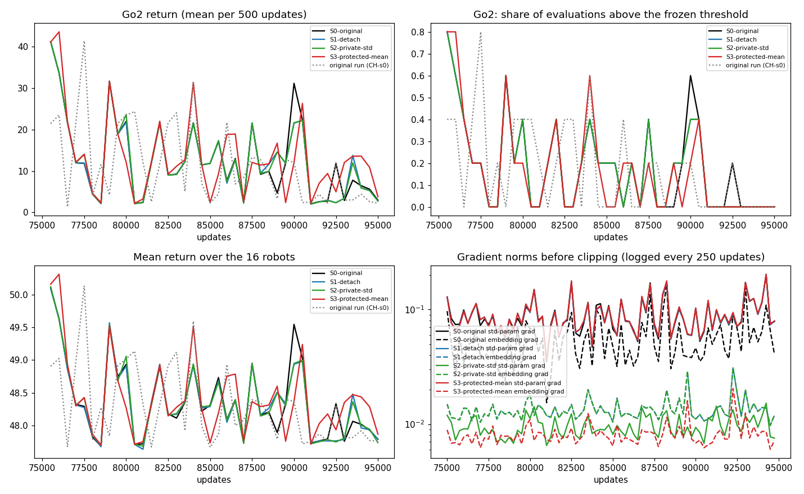
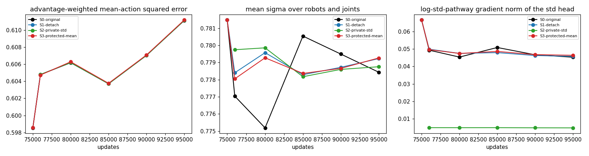

# Does variance learning contribute to the policy collapse? A controlled checkpoint-continuation test

Run on Hessian, 2026-10-06 20:44 to 2026-10-07 00:20 UTC. Everything below is from one checkpoint and one seed: **V7-CH-s0 (a C-H run) at 75,000 updates, target robot Go2**, continued for 20,000 updates in four branches.

## Answer in brief

**Evidence observed.**
- All four branches lose Go2 exactly as the original run does. Go2's return at +20k is 4.3 (S0 original), 4.0 (S1 detach), 4.0 (S2 private std), 7.4 (S3 protected mean) against 2.4 in the original run. Its walking share in the last 2,000 updates is 0.00 in every branch.
- No other robot changes status in any branch. The mean return over 16 robots is 47.8-48.1 in all four.
- The interventions were not no-ops. The descriptor embedding moved about as much between S1 and S0 (0.36) as S0's own embedding moved in 20k updates (0.375), and S3's core experts differ from S0's by 2.9 (S0 moved them 12.7). The mean policy and Go2's fate stayed the same.
- At the checkpoint the log-std pathway dominates the robot-averaged gradient (norm 0.080 against 0.034 through the mean; for the descriptor embedding 0.044 against 0.007), but the two pathways' gradients are orthogonal (cosine -0.001 overall, -0.018 on the embedding).
- The learned standard deviation does not grow or saturate: mean sigma 0.879 (Go2) and 0.781 (all robots) at the start, 0.874-0.879 and 0.778-0.779 at +20k, none at a clipping bound. The inverse-variance factor 1/sigma^2 therefore amplifies the mean gradient (w/sigma^2 averages 1.2-1.35 for Go2, 1.65-1.7 over robots) and does not suppress it.
- The advantage weights are close to 1 (Go2 mean 0.92-1.01, p99 about 1.2-1.4, about 0.02% clipped), so the actor objective is nearly plain weighted regression at these checkpoints.

**Plausible interpretation.** Variance learning through the three channels tested (variance gradients into the descriptor embedding, the shared std head, and inverse-variance weighting with shared clipping) is not what makes Go2 collapse from this checkpoint. The decline is carried by the mean pathway, where nearly all parameter movement is in the core experts (L2 distance 12.7 of 13.0 over the 20k updates; decoder experts 2.6, routers 1.2, descriptor embedding 0.38).

**What remains unproven.** One seed, one checkpoint, one robot; the interventions start at 75k, after Go2 was already declining, so they cannot show whether variance learning before 75k set the decline up. A checkpoint before the decline, or several seeds, could differ. Details and the one configuration I recommend next are in section 7.

## 1. Starting checkpoint and why

| | |
|---|---|
| Run, seed, update | V7-CH-s0 (hierarchical shared core + EG-group MI, seed 0), `models/at_75000`, 75,000 updates |
| Content | actor with Adam state, value critic, both critics and both target critics, full config; loaded with the V7 architecture through explicit legacy flags (joint encoder 4 units, 3-layer core, no WeightNorm), not the current defaults |
| Target robot | Go2 |
| Exact deterministic evaluation at the checkpoint | Go2 50.8 (walks); mean over the 16 robots 50.8; Cassie 1.1 and hexapod 0.1 already lost |
| Original run afterwards | Go2's mean return per 2k bin: 26 (74-76k), 17, 15, 13, 21, 9, 10, 9, 3 (90-92k), 6, 3, 3, 3 (98-100k); share of evaluations above the frozen threshold 0.45 at 74-76k, 0.00-0.05 from 90k. Exact evaluation at 100k: 2.6. All 15 other robots stay within 1 point of their 75k values to 100k |

**Why this checkpoint.** The request prefers a checkpoint before a Cassie collapse in an A, C or C-H run. Checkpoints exist only at 50k, 75k and 100k (`morse_save_at=50000,75000`), and Cassie's share of walking evaluations falls from its peak at 15-25k to 0.06-0.12 in the 45-50k window of CH-s0, A-s0 and C-s1; her exact evaluation at 50k is 1.0 (CH-s0) and 0.9 (A-s0). An A-H run (AH-s2 at 50k) has Cassie walking in 54% of the evaluations before 50k and collapsing by 60k, but its exact evaluation at 50k also shows her fallen (0.9), it is not an A, C or C-H run, and it lives on H100. So no A, C or C-H checkpoint precedes a Cassie collapse. The documented Go2 collapse in CH-s0 qualifies instead: Go2 walks at the 75k checkpoint (exact 50.8), the original run then deteriorates (to 2.6 at 100k), every other robot is stable, and all state is on Hessian. The checkpoint was chosen from the original run's records before any intervention result existed.

**Label.** This is a **learning-dynamics test from a mid-decline checkpoint**. Go2's walking share peaked near 60-70k (0.65-0.75) and was already about 0.45 around 75k, and under paired action noise (sigma 0.1 for 50 steps, 30 episodes) the checkpoint walks in only 13% of the episodes. Not prevention of a decline that had not begun.

## 2. What each branch changes

All four start from the same checkpoint with the same flags (core experts, decoder experts, routers, MI settings, balance, routing noise, critic training), seed 0, evaluation every 100 updates, a common horizon of **+20,000 updates** (to 95,000; the cosine learning-rate schedule keeps spanning 100k, so the rate at the start is that of update 75,000, 4.39e-5), and checkpoints at +1k, +5k, +10k, +15k and +20k. Code: `morse/variance.py`, `morse_variance_mode` in `morse/config.py`, `MorsePolicy`, `iql.py`; unit test 28 in `tests/test_morse.py`.

| Branch | Change (policy log-std is `rho_j = H(e_j)`, `e_j` the descriptor embedding, clipped to the same bounds) |
|---|---|
| S0-original | Gaussian AWR loss, shared head on `e_j`. Matched continuation control. |
| S1-detach | `rho_j = H(stopgrad(e_j))`; original Gaussian loss. Variance gradients reach the head only. |
| S2-private-std | **Deviation from the request.** The checkpoint's log-std is not constant over states (it follows the description, which varies by episode: spread up to 0.31 in log units, 0.17 for Go2), so a pure table of per robot-joint values is not an equivalent initialization and the request says to skip that case unless an equivalent one exists. Equivalent version: `rho_{r,j} = stopgrad(H(e_j)) + delta_{r,j}` with a learned offset `delta` per valid robot-joint pair, initialized to 0 (the starting log-std is exactly the checkpoint's); the shared head and embedding receive no variance gradient, and the head's restored Adam first moments were zeroed so it stays exactly fixed (distance to the source 0.0000). Original Gaussian loss. |
| S3-protected-mean | S1's detach plus the split losses `L_mu = E[w/2 mean_j (a-mu)^2]` (mean network only) and `L_sigma = E[w mean_j (rho + (a - stopgrad(mu))^2 / (2 e^{2 rho}))]` (head only), with the existing advantage weights, robot loss weights and valid-joint averaging, and the head clipped on its own (`grouped_clip_by_global_norm`, same max norm 0.5, an empty optimizer state so the restored state loads unchanged). The MI cap uses this loss's task gradient. A combined protection: it does not identify inverse-variance scaling and clipping separately. In practice the clip never acted (below). |

Adam moments of unchanged parameters are restored exactly in every branch. Two transients follow from restoring them: S2's new offsets start with zero moments (a first step about 3 times the nominal one: update norm 0.0021 against 0.0002 afterwards), and S3's restored second moments belong to gradients 1/sigma^2 (about 1.3-1.7) larger, so S3's early steps are smaller until they adapt.

## 3. Execution, runtime, failures

- **Attempt 1 failed.** All four runs (ids `VAR-S0..S3`) crashed between 79.5k and 80.3k updates with "Disk quota exceeded": the Hessian workspace quota is shared and was full (even a 1 MB probe failed; it later recovered to 8 GB). Their partial output stays in `runs/morse/VAR`, untouched, and is not used.
- **Attempt 2 (ids `VARb-S0..S3`)**, identical flags, restarted from the original 75k checkpoint (clean restart rather than resuming from the crashed runs' checkpoints, so each branch is one uninterrupted 20k-update continuation). Their run folders are symlinked to the node-local `/tmp/var_runs/VARb` so the shared quota cannot stop them; after the runs the checkpoints were copied to `$R/ckpt/VARb` in the workspace (1.6 GB) and the TensorBoard scalars and results to this folder.
- Four runs shared the two A100s (two per GPU): about 150 updates per minute each, about 2 h 15 min per run (S0 finished 00:10, S1 00:15, S2 00:14, S3 00:20 on the Hessian clock). No numerical failure; nothing was stopped early. Elapsed time for the batch 3 h 36 min from the first launch (including attempt 1), plus analyses to 00:35.
- The request's H100-duong fallback was not needed.

## 4. Starting equivalence and synchronization checks

Done inside every run at start (`branch_check.json`) and across runs (`sync_hashes.jsonl`):

| Check | Result |
|---|---|
| Starting action means of the branched policy against the checkpoint's own policy (2 fixed minibatches per robot, CPU) | max abs difference 5.5e-6 in all four branches (the policy evaluated twice on the CPU differs by the same float noise) |
| Starting log-std | max abs difference 1.2e-7 in all four, S2 included |
| Restored parameters, optimizer state, critics, value critic, target critics | bitwise equal (max abs difference 0) for every leaf the branch restores; S2's new leaves are `logstd_offset` and its two Adam moments |
| Optimizer step counts | 300,000 = 75,000 updates x 4 actor steps, in the Adam and the schedule state; learning rate at that count 4.39e-5, continuing |
| Minibatches and critics at the same update | 80 logged updates (75,000 to 94,750): identical content hashes of the minibatch stream, of both critics' parameters and of the value critic in all four branches |
| Randomness | training minibatches come from the seed's own stream; the routing noise has its own key stream (seed, update, actor step, robot), so it is paired across branches; diagnostics use fixed keys |

A note on the tolerance: on the GPU, one function evaluated twice on identical inputs differed by up to 1.9e-3 in the first eight robots (near-tied top-k routing), which is why the comparison is on the CPU.

## 5. Comparison at the common horizon (+20,000 updates)

Returns are the mean of the last 10 evaluations (one episode per robot every 100 updates) up to 95,000. "Walks" is the share of Go2's evaluations above the frozen threshold (26.2) in the last 2,000 updates. Weighted mean error and sigma are from the fixed-batch diagnostics at the 95k checkpoint (Go2 / mean over the 16 robots). Collapse = Go2 learned at the start (window mean 29.9 in the original run before 75k, threshold 26.2) and not at +20k.

| Branch | Target robot (Go2) return | Mean return across 16 robots | Weighted mean error | Std behavior (mean sigma) | Collapse observed |
|---|---:|---:|---|---|---|
| S0-original | 4.3 (walks 0.00) | 47.9 | 0.786 / 0.611 | 0.874 / 0.778, none at bounds | yes |
| S1-detach | 4.0 (0.00) | 47.9 | 0.786 / 0.611 | 0.876 / 0.779, none at bounds | yes |
| S2-private-std | 4.0 (0.00) | 47.8 | 0.786 / 0.611 | 0.879 / 0.779, none at bounds | yes |
| S3-protected-mean | 7.4 (0.00) | 48.1 | 0.786 / 0.611 | 0.876 / 0.779, none at bounds | yes |
| original run (CH-s0) | 2.4 (0.00) | 47.8 | | | yes |
| source checkpoint (75k) | 29.9 window, 50.8 exact | 50.8 exact | 0.769 / 0.599 | 0.879 / 0.781 | |

Go2, mean return per 1,000-update bin (share of evaluations above the threshold in brackets):

| Branch | +1k | +2k | +5k | +10k | +15k | +20k |
|---|---:|---:|---:|---:|---:|---:|
| S0-original | 37.5 (0.70) | 16.9 (0.30) | 20.5 (0.30) | 11.7 (0.20) | 21.5 (0.40) | 4.3 (0.00) |
| S1-detach | 37.5 (0.70) | 16.9 (0.30) | 20.3 (0.30) | 11.7 (0.20) | 16.7 (0.30) | 4.0 (0.00) |
| S2-private-std | 37.5 (0.70) | 16.9 (0.30) | 21.3 (0.30) | 11.7 (0.20) | 16.8 (0.30) | 4.0 (0.00) |
| S3-protected-mean | 42.4 (0.80) | 17.0 (0.30) | 15.5 (0.20) | 7.0 (0.10) | 7.2 (0.10) | 7.4 (0.00) |
| original run (CH-s0) | 22.5 (0.40) | 11.5 (0.20) | 22.5 (0.40) | 4.6 (0.00) | 12.4 (0.20) | 2.4 (0.00) |

Other measures of the same outcome:
- **Exact deterministic evaluation at the saved checkpoints** (`checkpoints.jsonl`, one episode per robot). Go2 flips between walking and fallen from checkpoint to checkpoint, so a single value says little: S0 1.2 (+1k), 50.7, 2.7, 50.8, 2.8 (+20k); S1 1.2, 50.8, 2.8, 50.9, 2.6; S2 1.2, 50.7, 2.7, 50.9, 2.7; S3 51.0, 51.5, 3.4, 50.5, 3.3. At +20k every other robot is within 1.5 points of the source.
- **Paired action noise** (N(0, 0.1^2) on the first 50 steps, the same draws for every checkpoint, 30 episodes): Go2's mean return 7.9 and walking share 0.13 at the source; at +20k 5.8, 5.7, 5.7, 9.1 (S0, S1, S2, S3) with walking share 0.00 in all; mean over robots 47.8 at the source, 47.7-47.9 at +20k.
- The four evaluation curves overlap almost point for point (`curves.png`): the same spikes appear at about 79k, 84k and 90k in every branch.
- Robots changing status by +20k: only Go2 (lost), in every branch and in the original run; no robot is gained.

How far the branches moved apart in parameter space (L2 distance, final checkpoints; `data/param_distances.txt`):

| Pair | all | descriptor embedding | std head | decoder experts | core experts | routers |
|---|---:|---:|---:|---:|---:|---:|
| S0 against the source | 12.99 | 0.375 | 0.019 | 2.59 | 12.67 | 1.22 |
| S1 against S0 | 0.58 | 0.361 | 0.023 | 0.29 | 0.35 | 0.045 |
| S2 against S0 | 0.62 | 0.361 | 0.019 | 0.29 | 0.41 | 0.050 |
| S3 against S0 | 3.12 | 0.378 | 0.024 | 0.90 | 2.91 | 0.54 |

S2's offsets stayed small (largest absolute value 0.039, mean 0.0065 in log units).

## 6. Variance and mean-learning diagnostics

Fixed minibatches of the checkpoint's own training data (it was trained on all rows, so no held-out episodes exist for it): 4 minibatches per robot, identical for every checkpoint and branch, with the advantage weights of each checkpoint's own critics. Clean routing; the same quantities with the router's training noise (identical keys for every checkpoint) agree to the shown digits (all values in `report_tables.md`). Cells are Go2 / mean over the 16 robots.

| Quantity | Source (75k) | S0 +20k | S1 +20k | S2 +20k | S3 +20k |
|---|---|---|---|---|---|
| Advantage-weighted mean-action squared error | 0.769 / 0.599 | 0.786 / 0.611 | 0.786 / 0.611 | 0.786 / 0.611 | 0.786 / 0.611 |
| Unweighted mean squared error | 0.789 / 0.626 | 0.788 / 0.625 | 0.788 / 0.625 | 0.788 / 0.625 | 0.788 / 0.626 |
| Mean sigma (none at a clipping bound) | 0.879 / 0.781 | 0.874 / 0.778 | 0.876 / 0.779 | 0.879 / 0.779 | 0.876 / 0.779 |
| Standardized squared residual (a-mu)^2/sigma^2 | 1.02 / 1.02 | 1.03 / 1.03 | 1.03 / 1.02 | 1.02 / 1.02 | 1.03 / 1.02 |
| Mean-learning weight w/sigma^2, mean (p99) | 1.27 (1.71) / 1.67 (2.33) | 1.25 (1.68) / 1.68 (2.30) | 1.24 / 1.68 | 1.23 / 1.68 | 1.24 / 1.68 (not applied in S3's mean loss) |
| Advantage weight w: mean, p99, share clipped at 100 | 0.98, 1.21, 0 / 1.00, 1.27, 0.0002 | 0.95, 1.16 / 1.00, 1.24, 0.0002 | same (critics are identical) | same | same |
| Effective sample size share of w | 0.69 / 0.54 | 0.97 / 0.54 | same | same | same |

Gradient mechanism (robot-averaged loss gradient, actual robot loss weights, split exactly by the pathway through which it reaches the parameters; norms):

| Quantity | S0 at the source | S0 at +20k | S1 at the source | S3 at the source | S2 at +1k |
|---|---:|---:|---:|---:|---:|
| Whole actor, through the mean | 0.0342 | 0.0346 | 0.0342 | 0.0210 (L_mu) | 0.0384 |
| Whole actor, through the log-std | 0.0799 | 0.0508 | 0.0665 | 0.0665 (L_sigma) | 0.0050 |
| Descriptor embedding, through the mean | 0.0071 | 0.0068 | 0.0071 | 0.0045 | 0.0086 |
| Descriptor embedding, through the log-std | 0.0441 | 0.0230 | 0.0000 | 0.0000 | 0.0000 |
| Std head (log-std pathway) | 0.0665 | 0.0452 | 0.0665 | 0.0665 | 0.0050 (offsets) |
| Cosine between the two pathways, all / embedding | -0.001 / -0.018 | 0.001 / 0.008 | 0 / 0 | 0 / 0 | 0 / 0 |

Training-time diagnostics (every 250 updates, means over 0-5k, 5-10k, 10-20k after the start; `report_tables.md` section 5):
- **Global clipping never acted.** The clip factor stays at 1.000 in every branch (period-mean gradient norm 0.06-0.13, single logged values up to about 0.2, against the max norm 0.5), and so did S3's separate clip on the head. The MI caps stayed at 1.000. The "protected clipping" part of S3 therefore had nothing to protect against here.
- Total gradient norm: S0 0.115, 0.126, 0.130; S1 0.105, 0.112, 0.115; S2 0.063, 0.068, 0.065; S3 0.092, 0.098, 0.103. Embedding gradient: S0 0.048, 0.056, 0.061 against 0.013, 0.014, 0.014 for S1 and S2 and 0.008 for S3. Std-parameter gradient: 0.083-0.094 in S0, S1 and S3, 0.009-0.010 for S2's offsets.
- Router task-gradient norms (the quantity the MI cap is measured against): core 0.0041 in S0-S2 and 0.0024 in S3; decoder 0.0135 and 0.0083. The ratio of about 0.6 is the removed 1/sigma^2 factor (sigma^2 averages 0.6).

## 7. Conclusions

**Evidence observed.**
1. S1 against S0 (variance-to-embedding coupling). Cutting the variance gradient into the descriptor embedding changes where the embedding goes (S1 and S0 end 0.36 apart, about as far as S0 moved in all 20k updates) and leaves Go2's trajectory, the mean policy's fit and every other robot as they are. The variance pathway is the larger share of the embedding's gradient at the checkpoint (0.044 against 0.007) yet orthogonal to the mean pathway's, and removing it did not change the outcome.
2. S2 against S1 (shared std parameters). Freezing the shared head and learning per robot-joint offsets adds nothing: S2 and S1 coincide, and the offsets barely move (largest 0.039 in log units).
3. S3 against S1 (protected mean). Fitting the mean without the 1/sigma^2 factor, the head clipped on its own, moves the core experts 2.9 away from S0's (a different trajectory) and Go2 still collapses (return 7.4 against 4.3 and 4.0, walking share 0.00 in all; this difference is within what a few single-episode evaluations give).
4. At this checkpoint variance learning has no sign of suppressing the mean gradient: sigma is stable at 0.87-0.88 (below 1, so w/sigma^2 is 1.2-1.35 for Go2 and 1.7 on average, not smaller than 1), none at a bound, and the advantage weights are close to 1.
5. The decline reproduces: S0 and the original run both end at about zero (Go2 4.3 against 2.4 at +20k) although S0 sees a different minibatch order; S0 is higher in some middle bins (11.7 against 4.6 at +10k), within the noise of 20 single-episode evaluations per bin. So the decline is a property of this checkpoint's dynamics, not of one data path.

**Plausible interpretation.** Go2's decline from this checkpoint does not run through the variance pathway. Where the policy actually moves is the mean pathway: the core experts account for 12.7 of the 13.0 L2 distance (decoder experts 2.6, routers 1.2). The checkpoint's Go2 gait is marginal (13% walking under small perturbations) and the weights are nearly uniform, so the objective is close to behavior cloning of a mixed dataset, and continued fitting of the other robots can tip Go2. I did not test that.

**What remains unproven.**
- Anything about variance learning before 75k. The branches start mid-decline; a different checkpoint or earlier intervention could behave differently (variance learning could still have shaped the descriptor embedding before the checkpoint).
- Generality: one seed, one checkpoint, one robot, one run per branch. Go2's evaluations are single episodes that flip between about 2 and 52, so differences of 0.1-0.15 in walking share are noise (the walking share per 2,000 updates rests on 20 evaluations).
- S3 is a combined intervention and its clipping part never acted, so S3 cannot separate scaling from clipping. S2 is the offset variant, not a pure table.
- Prevention. No collapse would not have proved prevention; here none was prevented, which says only that these three interventions do not stop this decline within 20k updates.
- The diagnostics use training data; Adam transients (sections 2) affect the first few hundred updates of S2 and S3.

**Recommended next configuration (one).** Freeze the core block (all core experts and the core router) at the 75k checkpoint and continue everything else with the S0 loss for 20k updates, compared with S0, with 3 data-order seeds each. The core holds nearly all the parameter movement, and S1-S3 left Go2's fate unchanged while moving the embedding and (S3) the core in different directions; if Go2 survives with a frozen core, the decline is core drift and the next step is to split it by expert group; if it still collapses, the cause is in the decoder or descriptor path through the mean. Not launched.

## Appendix: files, code and commands

**Results in this folder.** `report_tables.md` (all generated tables, including the training-noise rows and the training-time diagnostics), `results.json` (comparison values per robot), `curves.png`, `variance.png`, `data/tb/*.npz` (TensorBoard scalars of the four branches and the original run), `data/diagnostics/var-diag-S*_var.npz` (fixed-batch diagnostics; keys `c<i>_...`, `c<i>n_...` with training noise, checkpoint order in `checkpoints`), `data/noise_eval/*.json` (paired-noise evaluations), `data/meta/` (`branch_check.json`, `sync_hashes.jsonl`, `checkpoints.jsonl` with the exact evaluation of every saved checkpoint), `data/param_distances.txt`, `scripts/` (report generator `var_report.py`, row and launch scripts).

**Checkpoints and run folders on Hessian.** Source: `$R/repo/experiments/runs/morse/V7-CH/V7-CH-s0/models/at_75000` (untouched). Branches: `/tmp/var_runs/VARb/VARb-S{0..3}` (node-local, lost if the shell restarts) and copied to `$R/ckpt/VARb/` (+1k, +5k, +10k, +15k, +20k each). Logs: `$R/hq/runlogs/VARb-S*.log`. The failed first attempt: `runs/morse/VAR` (not used).

**Code changed (local repo, synced to Hessian, md5 identical).**
- `algorithms/morse/variance.py` (new): modes, protected loss, grouped clipping, state-spread check.
- `morse/config.py`: `morse_variance_mode` (original, detach, private, protected; default original), `morse_stop_at` (end after N updates in total while the cosine schedule keeps spanning `nr_offline_updates`), `morse_ckpt_var`, `morse_ckpt_var_noise`.
- `morse/policy.py`: `variance_mode` in the log-std head. `morse/updater.py`: gradient-norm, clip-factor and update-norm diagnostics (`morse/var/*`). `uni_iql_morse/iql/iql.py`: the protected loss, grouped clip in the actor optimizer, `check_branch` at the start of a branched run, the stop flag. `morse/ckpt_analysis.py`: `variance_diagnostics`.
- `tests/test_morse.py`: test 28 (starting forward passes, gradient isolation for each mode, the protected losses against their definitions, grouped clipping and optimizer-state structure) is new; the full suite (33 tests) passes on the final code on Hessian (`$R/analysis/var/tests_final.log`).
- Defaults are unchanged for existing runs (`original`, `stop_at` 0).

**Limits worth knowing.** The deterministic evaluation is one episode per robot per 100 updates; Go2 walks or falls in a given episode, and its window means have a standard error of 4-7 points. The analysis horizon ends at 95k, before the original run's 100k exact evaluation. The first start-state check on the GPU showed 1.9e-3 evaluation noise, so the equivalence checks are on the CPU.
