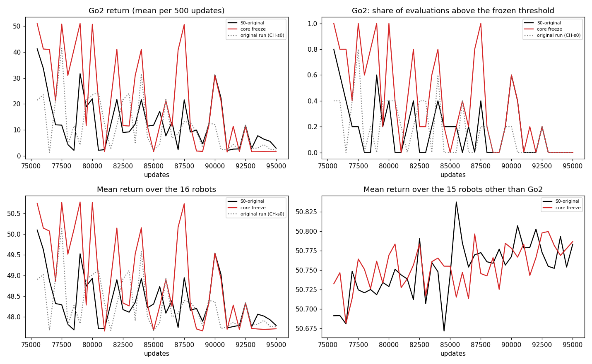

# Do updates to the core block contribute to Go2's deterioration?

Follow-up to the variance-continuation test (`../REPORT.md`). Same starting checkpoint, V7-CH-s0 at 75,000 updates; reference continuation S0-original (`VARb-S0`, 75k to 95k). Hessian, 2026-10-07 02:41 to 04:15 UTC (Hessian clock).

## Answer in brief

**Freeze still collapses: core updates were not necessary for this deterioration.** With the whole core block frozen (4,112,812 parameters, bitwise unchanged at every logged update and every saved checkpoint) and everything else training as in S0, Go2 ends as it does in S0:

| | Go2 return at +20k (window of 10) | Go2 walks, last 2k | Go2 exact at +20k | Go2 under paired noise (30 episodes) | Mean over 16 robots |
|---|---:|---:|---:|---:|---:|
| Source (75k) | 29.9 | 0.45 (74-76k) | 50.8 | 7.9 (walks 0.13) | 49.4 |
| S0-original | 4.3 | 0.00 | 2.8 | 5.8 (0.00) | 47.9 |
| Core freeze | 1.6 | 0.00 | 1.7 | 1.8 (0.00) | 47.7 |

No other robot changes: all 15 others end within 0.1 of S0's window mean (the largest difference between single evaluations of any of them is 3.4).

**What the freeze did change: the pace.** Go2 walked in 76% of evaluations in the first 5,000 updates with the core frozen against 34% in S0 (36% against 16% over the next 10,000; 8% against 6% in the last 5,000, z about 4.2, 2.3 and 0.4 by a two-proportion test that treats evaluations as independent, which overstates it). So core updates speed up the decline, and are not needed for it. The curves meet at about 90k.

**The checkpoint swaps pointed the other way, and the freeze shows why to read them cautiously.** Putting the 75k core into the 95k network restores Go2 (exact 51.0; under paired noise 49.2, walking 97%), and putting the 95k core into the 75k network does not (13.9; 10.9, 0%). Both mismatched networks damage other robots (G1 34.6, AnyB 43.7, AnyC 40.0 in the first; Talos 3.2 in the second), a co-adaptation effect. A network trained with the early core held fixed still loses Go2, so the late rest of the actor carries a Go2 failure that the early core, in that particular combination, happens to mask.

**Not shown:** which part outside the core produces the deterioration, and whether global, group-shared or routed core experts matter in other settings (not tested, as requested). One seed, one checkpoint.

## 1. Checkpoint component swaps (evaluation only)

Core = every parameter under `core`: core experts, shared (global and group) experts, router and router noise head (4,112,812 parameters in 24 leaves). Early = V7-CH-s0 at 75k, late = the S0-original continuation at 95k. The copies were written to node-local `/tmp/var_runs/swaps`; the saved checkpoints are untouched. Deterministic evaluation (one episode per robot, run twice, identical both times) and the paired-noise protocol of the variance report (N(0, 0.1^2) on the first 50 steps, 30 episodes, evaluation seeds 1000+e for every configuration).

| Configuration | Core | Rest of actor | Go2 exact | Go2 under noise: mean return (walks) | Mean over 16 robots, exact | Mean over 16 robots, under noise |
|---|---|---|---|---|---|---|
| Early reference | 75k | 75k | 50.8 | 7.9 (0.13) | 50.8 | 47.8 |
| Late reference | 95k | 95k | 2.8 | 5.8 (0.00) | 47.8 | 47.7 |
| Early-core swap | 75k | 95k | 51.0 | 49.2 (0.97) | 47.5 | 46.6 |
| Late-core swap | 95k | 75k | 13.9 | 10.9 (0.00) | 41.3 | 40.8 |

Robots that differ from their same-rest reference by more than 3 points (deterministic): early-core swap: G1 78.8 to 34.6 (below its frozen threshold 38.6), AnyB 48.2 to 43.7, AnyC 43.7 to 40.0; late-core swap: Talos 111.6 to 3.2 (lost), AnyB 48.2 to 46.8, Go2 2.8 to 13.9 (still fallen). All 16 robots per configuration are in `core_freeze_tables.md`.

**Reference check.** Both reference configurations pass through the same swap code and reproduce the saved policies bitwise (policy parameter hash equal to the checkpoint's: early true, late true); the swapped ones carry the intended core and rest hashes. Their evaluations equal the saved ones: exact Go2 50.8 and 2.8 as in `checkpoints.jsonl`, and the paired-noise numbers 7.9 (0.13) and 5.8 (0.00) equal the variance report's.

Caution (as asked): mismatched components can suffer from co-adaptation, and these four evaluations are supporting evidence, not a causal test. Here the swap suggested "the core carries the decline" and the freeze run did not confirm it.

## 2. The core-freeze run

Same checkpoint, flags, seed, data order, critic and actor settings (4 actor substeps), cosine schedule (rate at start 4.39e-5), routing-noise stream, evaluation every 100 updates and diagnostic steps every 250 as S0; checkpoints at +5k, +10k, +20k (S0 also saved +1k and +15k, which affects no random draw). One change: `morse_freeze_core=True`.

How the core is frozen (code: `morse/variance.py`, `uni_iql_morse/iql/iql.py`, `morse/updater.py`; unit test 29):
- **Forward and backward are unchanged.** The core stays in the computation with its original training-time routing noise; its gradient is computed and flows through it into the joint and foot encoders and the attention layers. Nothing is stop-gradiented (test: the joint encoder reaches the actor only through the core and still receives its gradient).
- **Optimizer.** The first element of the actor's optimizer chain, `frozen_clip_by_global_norm`, sets the gradient of every core leaf to zero before the global-norm clip. The restored Adam first moments of the core leaves are set to zero at the start (a zero gradient alone would still move them by the restored momentum: the test shows that), so their update is exactly zero. The restored Adam state of every trainable parameter and the step counts (300,000 in the Adam and the schedule state) are kept; the optimizer state keeps its structure.
- **Clipping and auxiliary losses.** The clip sees the trainable gradient only: the frozen core's gradient neither updates the core nor enters the clip's norm, so it cannot rescale the trainable gradient. The core router's MI and balance gradients (they reach only that router) are excluded the same way; decoder MI, decoder balance and the task loss are unchanged. Both clip factors are logged (below).

## 3. S0 against core freeze: returns

Returns are the mean of the last 10 evaluations (one episode per robot every 100 updates) up to the horizon; "walks" is the share of Go2's evaluations above the frozen threshold (26.2).

Go2, mean return per 1,000-update bin (walking share in brackets):

| Run | +1k | +2k | +5k | +10k | +15k | +20k |
|---|---:|---:|---:|---:|---:|---:|
| S0-original | 37.5 (0.70) | 16.9 (0.30) | 20.5 (0.30) | 11.7 (0.20) | 21.5 (0.40) | 4.3 (0.00) |
| Core freeze | 46.1 (0.90) | 31.1 (0.60) | 31.2 (0.60) | 6.5 (0.10) | 21.2 (0.40) | 1.6 (0.00) |
| Original run (CH-s0) | 22.5 (0.40) | 11.5 (0.20) | 22.5 (0.40) | 4.6 (0.00) | 12.4 (0.20) | 2.4 (0.00) |

Go2's share of evaluations above the threshold, by 5,000-update period (50 evaluations each):

| Period | S0 | Core freeze |
|---|---:|---:|
| 75-80k | 0.34 | 0.76 |
| 80-85k | 0.16 | 0.36 |
| 85-90k | 0.16 | 0.36 |
| 90-95k | 0.06 | 0.08 |

Exact deterministic evaluation of the saved checkpoints (Go2 / mean over 16 robots): S0 +5k 50.7 / 50.7, +10k 2.7 / 47.7, +20k 2.8 / 47.8; core freeze +5k 50.5 / 50.8, +10k 1.7 / 47.7, +20k 1.7 / 47.7. Go2 flips between walking and fallen from one checkpoint to the next in both runs (S0's +1k and +15k checkpoints: 1.2 and 50.8), so single values say little.

Per-robot return at the horizon (window mean of the last 10 evaluations; the source is the original run before 75k):

| Robot | Source | S0 | Core freeze | Freeze minus S0 |
|---|---:|---:|---:|---:|
| a1 | 14.4 | 14.4 | 14.4 | +0.0 |
| go1 | 14.5 | 14.5 | 14.5 | +0.0 |
| go2 | 29.9 | 4.3 | 1.6 | -2.7 |
| anyb | 48.0 | 48.1 | 48.1 | -0.0 |
| anyc | 43.7 | 43.8 | 43.8 | +0.1 |
| bkv0 | 47.2 | 47.0 | 47.0 | +0.1 |
| bkvb | 55.1 | 55.1 | 55.1 | +0.0 |
| bg | 52.6 | 52.6 | 52.6 | -0.0 |
| bit | 45.7 | 45.9 | 45.9 | +0.1 |
| h1 | 54.6 | 54.7 | 54.7 | -0.0 |
| g1 | 78.5 | 78.7 | 78.7 | +0.0 |
| tl | 111.2 | 111.5 | 111.5 | +0.0 |
| op3 | 102.8 | 102.8 | 102.8 | +0.0 |
| nao5 | 91.2 | 91.3 | 91.3 | +0.0 |
| cas | 1.2 | 1.2 | 1.2 | -0.0 |
| hx | 0.1 | 0.1 | 0.0 | -0.0 |

By the frozen thresholds only Go2 is lost, in both runs; none is gained.

Go2's advantage-weighted mean-action error on fixed training minibatches (4 per robot, identical for every checkpoint; Go2 / mean over robots): source 0.769 / 0.599; +5k S0 0.790 / 0.606 and freeze 0.790 / 0.606; +10k 0.786 / 0.604 and 0.787 / 0.604; +20k 0.786 / 0.611 and 0.787 / 0.612. Mean sigma 0.879 / 0.781 at the source and 0.874 / 0.778 (S0) and 0.874 / 0.779 (freeze) at +20k. The fit of Go2's data is the same with and without the core's updates.

## 4. Proof that the core stayed unchanged

- SHA-1 over the 24 core leaves: checkpoint d14c95f85844f519...; the branched run's core at its start: equal (also checked as part of the run's start checks).
- The run logs the core's hash at every logged update (every 250 updates, 80 updates from 75,000 to 94,750): one distinct value, equal to the checkpoint's.
- Saved checkpoints at +5k, +10k and +20k: core hash equal to the source's in all three (`data/meta/VARc-F0/core_hash_checkpoints.json`; the +20k policy differs from S0's by 12.67 in the core experts, and from the source's by 0.0000).
- The update applied to the core at every logged step has norm 0.0 (80 logged steps), while the core's gradient is computed (mean norm 0.0324) and discarded. Trainable parameters moved: the whole actor's update norm averages 0.0024 against 0.0087 in S0 (the core accounts for most of S0's movement).

Clipping and caps (logged every 250 updates):

| Logged | Core freeze | S0 |
|---|---:|---:|
| Clip factor actually applied, minimum | 1.000 | 1.000 |
| Clip factor with the core's gradient included, minimum | 1.000 | (same) |
| Gradient norm of the trainable parameters, mean | 0.1206 | 0.1252 (core included) |
| Decoder MI cap factor, mean | 1.000 | 1.000 |
| Core MI cap factor, mean (the core router is frozen) | 1.000 | 1.000 |
| Decoder router task-gradient norm, mean | 0.0135 | 0.0135 |

The clip never acted in either run (norms 0.06-0.2 against the maximum 0.5), so excluding the core from the clip's norm introduced no coupling that could explain the result; the log would show one.

## 5. Data and critic synchronization with S0

80 logged updates in common (75,000 to 94,750): identical minibatch-stream hashes, identical critic parameter hashes and identical value-critic hashes. The routing noise has its own key stream (seed, update, actor step, robot), the main key stream splits the same way in every mode, the diagnostic steps are the same, and the freeze draws no random number, so the control is matched. The existing S0 was reused, not rerun. In the dry run, before launch, the first four logged updates also matched a separate earlier dry run of S0.

## 6. Runtime, completed updates, deviations

- **Completed:** 20,000 updates (75,000 to 95,000), 95,001 logged steps, no traceback, no numerical failure. Training ran at about 265 updates per minute on one A100 (GPU 0, alone after the first minutes), about 76 minutes after a 7-minute compile and data load; started 02:41, finished 04:03 (Hessian clock). Swap evaluations about 20 minutes (GPU 0, before the run), post-run analyses about 10 minutes (GPU 1).
- **Outputs:** run folder on node-local `/tmp/var_runs/VARc/VARc-F0` (symlinked as `runs/morse/VARc`), run id `VARc-F0`. Durable copies: checkpoints at +5k, +10k, +20k and the run's metadata in `$R/ckpt/VARc/VARc-F0` on the workspace (235 MB, compared with the node-local files by `diff -rq`: identical); TensorBoard scalars, diagnostics, evaluations and reports in this folder (`data/`). Nothing was deleted; the original checkpoints and the earlier results are untouched.
- **Deviations from the request:** none in the training protocol. Evaluation interval equals S0's (every 100 updates, not 500). The control S0 ran on the code before the freeze was added; S0's own path (`original` mode) is unchanged by it, and the matched hashes show the data and critics are the same. Checkpoints at +5k, +10k, +20k only (S0 also has +1k and +15k).
- The H100-duong fallback was not needed.

## 7. Interpretation

**Evidence observed.**
1. Core updates are not necessary for Go2's deterioration in this continuation: with the core exactly fixed, Go2 falls from walking in 76% of evaluations (first 5,000 updates) to 8% in 90-95k and 0% in the last 2,000 updates, ends at 1.6, and its exact evaluation is 1.7 at +10k and +20k.
2. The core's updates do change the pace: the decline is slower with the core frozen during the first 15,000 updates (walking share 0.76 against 0.34, then 0.36 against 0.16), and the two runs coincide from about 90k.
3. Nothing else is harmed by freezing the core: the other 15 robots end within 0.1 of S0.
4. The data fit of Go2 does not depend on the core updates (weighted mean error 0.786 against 0.787 at +20k), and the non-core parts moved at least as far as in S0 to make up for it: decoder experts 3.11 against 2.59 (from the source), descriptor embedding 0.38 against 0.38, attention layers 0.21 and 0.14 against 0.14 and 0.11, the decoder router 0.83 (S0's routers figure, 1.22, includes the core router). These distances are descriptive; magnitudes do not locate a cause.
5. The swaps and the freeze disagree on the core's role. The swaps show where Go2's walking is recoverable by exchanging the core (early core with late rest walks, 97% under noise), at the price of other robots (G1, AnyB, AnyC; Talos in the reverse swap), i.e. the pieces are co-adapted. The freeze shows the late rest can lose Go2 without any core update.

**Plausible interpretation.** Go2's decline is produced by changes outside the core (decoder experts and router, descriptor embedding, encoders or attention), with the core's updates making the same decline faster; the early core can mask the failure of a late rest in the swap only because of how those parts fit each other. Not proven.

**What remains unproven.** Which outside component matters; whether the early delay is a property of freezing or of this seed (the walking shares rest on 50 correlated single-episode evaluations per period); whether global, group-shared or routed core experts matter (not tested, by request); behavior of other robots or checkpoints. The earlier variance test excluded the log-std pathway; this one excludes the core. The mean pathway through the decoder and the descriptor embedding remains.

**Recommended next experiment (one, not launched).** Freeze the core and the decoder (decoder experts and decoder router) together, leaving only the descriptor embedding, the state encoders, the attention layers and the std head trainable, same checkpoint and protocol, 75k to 95k, against S0 and the core freeze. If Go2 still collapses, the cause is in the shared descriptor and encoder pathway; if it holds, it is in the decoder (the freeze of the core alone did not prevent it, so the two together isolate the decoder). Repeating S0 and the chosen freezes with three data-order seeds would be the confirmation run, because the early-delay result and Go2's single-episode evaluations are noisy.

## Appendix: files

`core_freeze_tables.md` (all generated tables), `core_freeze_results.json`, `core_freeze_curves.png`, `data/` (`swap/` evaluations and swap report; `tb/VARc-F0.npz`; `meta/VARc-F0/` branch check, sync and core hashes, checkpoint records; `diagnostics/var-diag-F0_var.npz`; `noise_eval/var-noise-F0_noise.json`; `param_distances.txt`), `scripts/`. Code: `morse_freeze_core` (config), `frozen_clip_by_global_norm`, `zero_first_moments`, `is_core` in `morse/variance.py`; the core hash in `sync_hashes.jsonl`; `morse/var/*` clip, gradient and update logs; unit test 29 in `tests/test_morse.py`.
